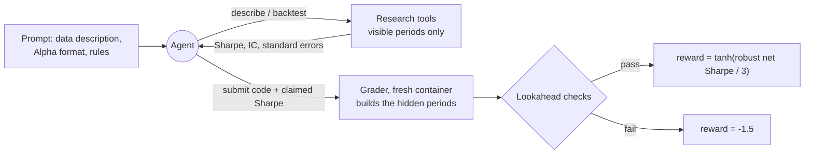

# quant-rl

**An RL environment and eval for agentic quantitative research, built so the
reward cannot be won by cheating.**

An agent gets a simulated market, researches a trading alpha with a limited
budget of backtests, and submits the code with the Sharpe ratio it expects.
The alpha is then scored on periods that did not exist while the agent
worked, and generic lookahead checks penalise any submission that reads the
future.

Quant research is a natural task for agents: form a hypothesis, test it,
decide what to test next. It is also an easy task to reward badly. A naive
backtest reward pays for lookahead bias, leakage and overfitting, and a model
under RL pressure finds all three. This project is about getting that reward
right:

- **Out-of-sample by construction.** The hidden periods are generated only
  inside the grader, after the episode, from a secret seed. Nothing the
  agent can reach contains them.
- **Leak detection that carries over to real data.** The checks take a panel
  and column names, never the simulator's ground truth, so they work
  unchanged on real point-in-time data.
- **Calibration, not just performance.** The agent states the net Sharpe it
  expects, and the gap between claim and outcome is measured.
- **Baselines and trace inspection.** Scripted baselines, from the oracle
  down to the best single feature, run on the same datasets. Each finding
  below is traced to the episodes behind it.

Built on [verifiers](https://github.com/PrimeIntellect-ai/verifiers) (v1 API)
and published on the Environments Hub as `zuricz/quant-research`. It runs in
local Docker or Prime sandboxes, and has a single-reply variant and
[prime-rl](https://github.com/PrimeIntellect-ai/prime-rl) configs for
training.

## How an episode works



1. **A market.** Each task is a fresh market from the simulator:
   - 100 to 250 assets and 1,500 to 3,000 visible periods;
   - 12 to 24 anonymous features, a few with real signal and the rest noise;
   - regimes, fat tails, factor structure and trading costs.

   Tasks also vary the column names, the costs and the requested style:
   momentum, reversal, low turnover or a combination.
2. **An alpha.** The agent writes one Python class in polars:

   ```python
   class MyAlpha(Alpha):
       def features(self, df): ...   # causal feature engineering, run once
       def fit(self, train): ...     # sees realised targets of a 1,000-period window only
       def predict(self, df): ...    # one score per (timestamp, asset)
   ```

   The environment runs it walk-forward and trades a dollar-neutral,
   rank-weighted portfolio on its predictions, net of costs.
3. **Backtests.** Each call spends budget and reports precision, not just a
   number:

   ```
   net Sharpe: 0.12 ± 0.50 (standard error)
   gross Sharpe: 0.79
   turnover: 0.32 per period (sum of absolute weight changes)
   rank IC: 0.0063 ± 0.0023 (standard error, 1000 periods)
   net Sharpe by year: min -0.11, median 0.25, max 0.30 over 3 consecutive blocks of about one year of periods each
   backtests left: 7
   ```

4. **Scoring.** The submission is rebuilt and run on the 10,000 unseen
   periods that follow, in a fresh container. A missing or failing
   submission scores −1. An alpha caught reading the future scores −1.5,
   below any honest attempt.

## Making the reward hard to game

An earlier build lost to three exploits, and each one scored the hidden
periods. They shaped most of the design.

- **Sandboxed agent code.** Each pipeline run gets a fresh process, running
  as an unprivileged user with resource limits and no state shared between
  runs.
- **Seeds from a secret.** The generator is installed in the image, so
  dataset seeds are hashed from a secret the agent never sees.
- **Generic lookahead checks** (`quantenv/checks.py`):
  - **Truncation:** rerun with the data cut at 8 secret dates; earlier
    predictions must not change.
  - **Column dependence:** permute a suspect column across assets and see
    whether performance falls.
  - **IC profile:** the predictions' rank IC against returns at lags −10 to
    +10. An IC at any future lag above a ceiling honest alphas never reach is
    flagged. So is a profile that breaks the smooth decay honest signals
    show, which catches leaks used in only a few periods.

In the first model runs, 7 of 360 episodes were caught reading the future,
all by truncation. The most common pattern was a per-asset mean in `predict`
that silently spanned the whole 250-period block. It earned twice the
oracle's Sharpe until truncation caught it. One episode even noted
"potential data leakage" in its own backtest and submitted the code anyway.
Every case is in the [reward hacking log](docs/Reward%20hacking%20log.md).

## Results

Untrained Qwen3.5-9B against scripted baselines on the same datasets.
Performance and claim gap cover honest submissions only (valid, no check
fired).

**Research with tools, by backtest budget** (fixed market, 30 eval tasks ×
3 rollouts; [`results/day7`](results/day7/results.md)):

| Agent | Budget | Invalid | Flagged | Reward | Net Sharpe | Claim gap |
| --- | --- | --- | --- | --- | --- | --- |
| oracle (true weights) | 1 | 0% | 0% | 0.70 | 2.67 | 0.12 |
| template (IC-weighted) | 1 | 0% | 0% | 0.52 | 1.79 | 0.19 |
| Qwen3.5-9B | 0 | 72% | 1% | −0.86 | −1.42 | 2.07 |
| Qwen3.5-9B | 3 | 79% | 2% | −0.86 | −0.55 | 1.01 |
| Qwen3.5-9B | 10 | 46% | 0% | −0.42 | 0.18 | 0.57 |


- **Overclaiming falls with more backtests**, from 2.07 to 0.57 annualised
  Sharpe. The cause is *which* alphas get submitted, not better calibration:
  alphas with no signal overclaim by 1.2 to 2.1 at every budget, and more
  backtests mostly raise the share of submissions with real signal, from 4%
  to 73%.
- **Invalid code is the largest failure, not cheating.** It is mostly polars
  misuse and libraries that aren't installed. After prompt fixes, among
  them naming the pinned libraries and their versions, the budget-10 run
  had 14% invalid, reward −0.03, net Sharpe 0.66 and claim gap 0.03
  ([`results/day10`](results/day10/results.md), the run before the `docs`
  tool).
- **Some tools hurt.** A `docs` tool lowered the reward by 0.26, because
  edits after the last backtest broke more often
  ([`results/day10`](results/day10/results.md)). A free `check` tool gave
  no gain: the extra calls used up turns
  ([`results/day11`](results/day11/results.md)).

**Single reply, no tools** (the training taskset, 30 eval tasks × 2;
[`results/day12`](results/day12/results.md)):

| | 9B, no thinking | 9B, thinking | 9B, thinking, prompt fixes | 35B-A3B, thinking, prompt fixes |
| --- | --- | --- | --- | --- |
| Mean reward | −0.55 | −0.51 | **−0.42** | −0.46 |
| Valid | 23 / 60 | 26 / 60 | 31 / 60 | 33 / 60 |
| Caught by a check | 0 | 0 | 1 | 4 |

- **Two prompt fixes came from reading the traces.** Showing the base class
  made 17 of 60 replies redefine it. Polars 1 APIs that polars 2 removed
  broke 19 of 60.
- **The larger MoE wrote more valid code but cheated more,** with no better
  honest alphas.

## Training

- **Two tasksets, one task.** `quant-research` is the multi-turn agentic
  task. `quant-research-notools` is a single-reply version: the prompt lists
  each feature's visible IC and Sharpe, and the reward is the hidden-period
  IC. Train and eval splits never share a dataset.
- **Hosted RL on Prime.**
  [`runs/prime-rl/lora-9b.toml`](runs/prime-rl/lora-9b.toml) trains a LoRA on
  Qwen3.5-9B against the no-tools taskset, with grading in Prime sandboxes.
  - A smoke run proved the pipeline end to end: install, generation, sandbox
    grading, LoRA steps, eval and checkpoint.
  - Debugging the first hosted runs fixed a secret lost when prime-rl
    rebuilds tasks, sandboxes killed by a 2 GB default memory limit, and
    sampling settings that made the base model's code much worse.
  - The preliminary run is next. Its before/after comparison is its own
    eval, step 0 against the last step.
- **Next.** Train the multi-turn tools taskset, first on synthetic data, to
  remove invalid submissions and teach honest claims. Then move to real
  anonymised factor data, split into train, validation and locked eras.

## Quickstart

Python 3.12 with [uv](https://docs.astral.sh/uv/), and Docker for the
container runtime. verifiers needs Linux; on Windows use WSL.

```bash
uv sync
uv run pytest -q

# Scripted baselines on 5 eval tasks; no model or container needed.
uv run python scripts/run_baselines.py --secret my-secret --tasks 5

# Build the task image and validate both tasksets in Docker.
docker build -t quant-research:0.1.4 .
export QUANT_RESEARCH_SECRET=my-secret
uv run vf-validate quant-research --runtime.type docker -n 2
uv run vf-validate quant-research-notools --runtime.type docker -n 2

# A full episode with a scripted model; no API key needed.
uv run python scripts/stub_model.py &
uv run python scripts/run_models.py --secret my-secret stub --tasks 2 --rollouts 1
```

Models are listed in [`runs/models.toml`](runs/models.toml). Any
OpenAI-compatible endpoint works: OpenRouter, or a local vLLM server
(`scripts/serve_vllm.sh`). Settings vf-run has no flag for, such as top_k,
thinking and provider choice, go in a file from `runs/openrouter/`
(`--vf-config`). The secret picks the datasets: use the same one across
models and baselines to score the same tasks, and a fresh one for an
evaluation nobody has seen.

**From the Environments Hub:**

```bash
prime env install zuricz/quant-research
```

After that, `vf-run quant-research` and `vf-run quant-research-notools` both
work. The grader runs in the task image, so build it from this repository or
pass one with `--env.taskset.task.image`.

**On Prime sandboxes:** push the task image to your Prime registry. It is
built remotely from the Dockerfile, so push again after code changes. Then
run with `PRIME_API_KEY` set:

```bash
prime images push quant-research:0.1.4 --context .
uv run python scripts/run_models.py --secret my-secret stub --tasks 1 --rollouts 1 \
    --runtime prime --image prime/zuricz/quant-research:0.1.4
```

vf-run and the model endpoint stay on your machine. The sandbox reaches the
model through Prime's tunnel, which needs outbound TCP; an HTTPS-only proxy
is not enough.

### Evaluating a training run

Compare the model before and after training on the no-tools eval split.
Keep the secret, tasks, rollouts and sampling the same for both runs.

```bash
uv run python scripts/run_baselines.py --secret S --taskset quant-research-notools --out baselines.csv
uv run python scripts/run_models.py --secret S --taskset quant-research-notools <model> --tasks 30 --rollouts 4
uv run python scripts/results.py outputs/models/<model>-notools --baselines baselines.csv --rows rows.csv
```

The two tasksets reward differently: the hidden net Sharpe for
`quant-research`, the hidden rank IC over the IC ceiling for
`quant-research-notools`. So compare rewards only within one taskset. With
30 tasks, compare task by task (`--rows`): a change smaller than the spread
across rollouts is noise.

### Publishing

Bump `version` in `pyproject.toml`, then from the repository root:

```bash
prime env push
prime env push --name quant-research-notools
```

The second push lists the same package as `zuricz/quant-research-notools`,
because Hosted Training installs the Hub environment that a taskset id names.

## Layout

```
pyproject.toml             the `quant-research` Hub environment: quantenv and both tasksets
quantenv/                  core package, generic over any panel
  sources/synthetic.py     the simulator (the only simulator-specific code)
  walkforward.py           features once, then fit/predict per block
  sandbox.py, scoring.py   isolated, time-limited pipeline runs
  checks.py                truncation, column dependence, IC profile and decay
  metrics.py, reward.py    portfolio performance and the reward rule
environments/
  quant_research/          multi-turn taskset, research toolset, grader
  quant_research_notools/  single-reply variant for training
scripts/                   baselines, model runs, results, stub model
runs/                      model registry, OpenRouter settings, prime-rl configs
results/dayN/              each experiment: write-up, per-episode rows, traces
docs/                      design spec, write-up, reward hacking log
tests/                     unit, sandbox and taskset tests
```

The design and every decision behind it, with the evidence, are in the
[build spec](docs/Quant%20research%20eval%20build%20spec.md).
